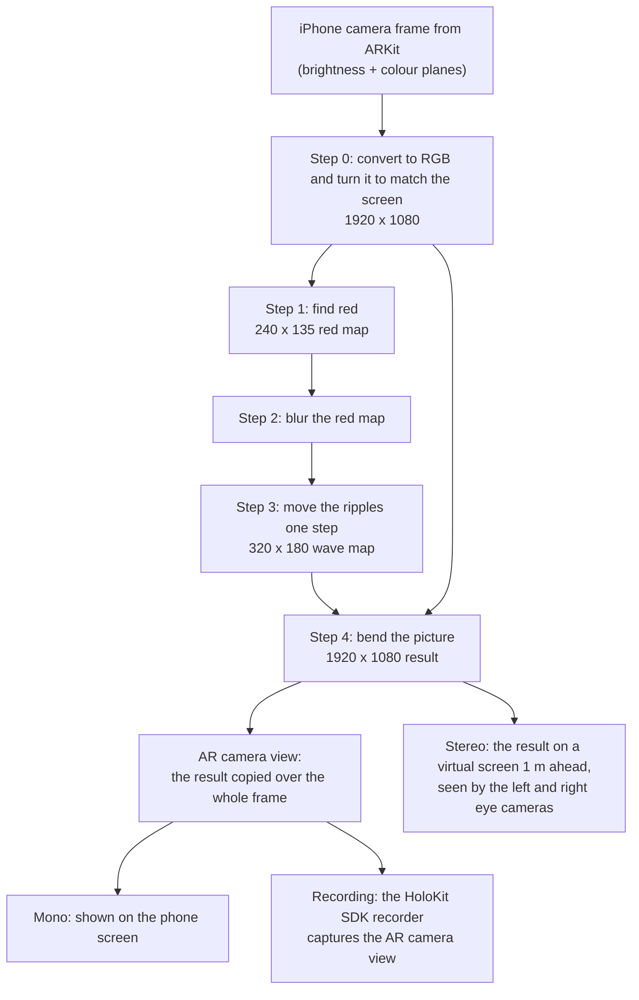

# TransVision 

Exploring the State of the Visual Field in the Age of Extreme Augmentation

## Thematic Statement
Human perception has long been influenced by technological breakthroughs. An intimate mediation of technology lies in between our direct perceptions. Through three extreme ideal types of perceptual machines, this project defamiliarizes and questions the habitual ways in which we interpret, operate, and understand the visual world intervened by digital media.   

Hyperallergenic Vision 

We have observed an increase in allergies and intolerances in modern society. Hypersensitivities are emerging not only medically but also mentally. Digital media reinforce people’s tendency to overreact through the viral spread of information and amplification of opinions, making us hypersensitive to our sociopolitical environment. By creating an artificial allergy to the color red, this machine manifests the nonsensical hypersensitivity created by digital media. In nocebo mode, red expands, which is similar to social media’s amplification effect; in placebo mode, red shrinks, like our filtered communication landscape where we can unfollow people with different opinions.

Tactile Vision 

Obsessively searching online for one thing is like looking through a pinhole where we build up everything without an overview. This machine helps to make the wearer conscious of how we navigate the internet naturally narrows our views of the world. The silicon mask breathes gently when the light is far away, while rapidly when the light gets closer. The wearer can navigate in space and find each other in total darkness with this tactile vision, like a dating App for cave animals. Similar to searching, when you are only looking for one thing, you lose the capacity to see things in context to make more informed decisions.

Commoditized Vision 

Our visual field is packed with so much information that our perception has become a commodity with real estate value. By creating tension between the meditative state and the consumptive state, this machine contemplates how our perception has become part of the value chain in this particular socioeconomic context. You can earn money by looking at advertisements, and spend money to see an ads free world.

## Implementation
TransVision is an AR mobile application where we implemented Hyperallergenic Vision for expanding red zone. 
<div>

</div>

## Requirement
iPhone 12 or above, iOS 27 or later.

## How to play
You can download the app from app store by searching "TransVision". 
- Mono Mode<br>
  In this mode, users can interactive with TransVision without HoloKit.
- Stereo Mode<br>
  In this mode, user can get a more immersive AR experience with HoloKit.

## How it works
In short: every frame, the app takes the picture from the iPhone's back camera, finds the red parts, bends the picture so the red spreads and moves like a liquid, and shows the result. In Mono the result fills the phone screen. In Stereo it is shown on a virtual screen 1 m in front of you inside HoloKit.

The whole app is one Unity scene. The image work runs on the phone's GPU, in small programs called shaders.



### Words used below
- **Texture**: an image the GPU can read. A **render texture** is one the GPU can also draw into.
- **Shader**: a small program that runs on the GPU once for every pixel, all pixels at the same time.
- **UV**: a position inside a texture, from (0, 0) at one corner to (1, 1) at the other.
- **Pass**: one shader run that reads some textures and writes one texture.

### Step 0: get the camera picture
ARKit gives each camera frame as two textures: a brightness image (Y) and a colour image (CbCr). This is how video is usually stored. `TransVisionCameraImage.shader` combines them into normal RGB colours.

The camera sensor does not match the screen: its image is a different shape and may be rotated. ARKit provides a "display transform", a small matrix that says which point of the camera image belongs at each point of the screen. The shader uses it so the picture comes out the right way up and cropped like the screen. The app reads this matrix from the AR background material just before rendering, after the HoloKit SDK has corrected it. On iOS 27 the matrix inside the raw frame is wrong, and using it shows the picture in the wrong orientation.

In the Unity Editor there is no camera, so a still test image is used instead.

### Steps 1 and 2: find the red
"Red" here means a colour whose hue is within about 20 degrees of pure red and that is not greyish. Checking only "is the R value high" would also catch white, orange and skin. So the shader converts each colour to brightness plus two colour-difference values (Cb and Cr), the same split video uses, and measures the direction and strength of the colour in that Cb/Cr plane.

This runs on a small 240 x 135 map; each cell averages 16 camera samples. The result is a "red map" from 0 (no red) to 1 (fully red), like a heat map. Two blur passes, one horizontal and one vertical, then soften its edges so the effect has no hard border.

### Step 3: ripples
Ripples come from a classic 2D wave simulation on a 320 x 180 height map. Every frame, each cell's next height is (the sum of its four neighbours) / 2 minus its height one frame ago, multiplied by 0.975 so waves die out. Six times a second, random "drops" fall inside the red and start new waves. The map keeps the last two frames, so three textures take turns.

### Step 4: bend the picture
This is the main trick. To bend an image, each output pixel reads the camera picture from a slightly shifted position. Shifting where you read is what water or wavy glass does to the light. The shift for each pixel is the sum of five parts:

| Part | What you see | How it is computed |
|---|---|---|
| Spread | Red grows outward (nocebo) | Shift along the slope of the blurred red map, toward more red. A negative strength makes red shrink (placebo). |
| Flow | Inside the red, the picture keeps swirling | Two layers of drifting noise, one bending the other |
| Ripples | Rings spreading from drops in the red | The slope of the wave map from Step 3 |
| Bubbles | Round lenses drifting inside the red, with a dark rim and a highlight | A pre-made bubble texture, two layers that fade into each other |
| Still warp | The rest of the view is slightly wavy but does not move | The same noise as Flow, without time |

Flow, ripples and bubbles fade out toward the red's edge. So the red parts move like liquid while everything else stays still with only a small, fixed warp.

The noise and bubble textures (256 x 256) are generated once when the app starts (`LiquidTextures.cs`).

### Where the steps run
Unity's Universal Render Pipeline (URP) draws each camera with a list of passes. `CameraImageProcessor` adds one extra pass, `EffectPass`, to the first camera that renders each frame, and that pass runs Steps 0 to 4. Stereo has two eye cameras, but the effect still runs only once per frame. Only the input and the result are full size; the red map and the wave map are small, which keeps the GPU work low.

### Showing it in Mono
The result already has the screen's layout, because Step 0 used the screen's display transform. So `DisplayPass` copies it over the whole screen after the normal camera background. The buttons are drawn on top afterwards.

### Showing it in Stereo (HoloKit)
In Stereo, the phone screen is split into a left and a right image, and you look at them through HoloKit's lenses. The HoloKit SDK renders them with two eye cameras, placed where your eyes are.

The problem is that the picture comes from the phone's camera, not from your eyes. The camera sits 7.8 cm in front of your eyes and 6.2 cm above them, and the app has no depth information, so it cannot know how far away each pixel is.

The solution is a virtual screen, `ResultPlane`, that shows the camera picture and fills exactly the camera's field of view at a distance of 1 m:

```
                      iPhone camera o----------------- 1 m ----------------|
                                    |                                      |  virtual screen:
                             6.2 cm |                                      |  the camera picture,
                                    |                                      |  exactly as wide and tall
    your eyes o---------------------+                                      |  as the camera sees at 1 m
              |<----- 7.8 cm ------>|
```

`PlanePlacer.cs` sizes it from the camera's projection matrix, which describes how wide and tall the camera sees. At distance d, the screen is 2d / m00 wide and 2d / m11 tall, and slightly off centre (m02, m12), because the lens centre of an iPhone camera is not exactly in the middle of the image. The screen is attached to the camera, so it follows your head without delay.

Because the screen is flat, objects exactly 1 m away line up with the real world. Nearer objects look a little lower and larger, and farther ones a little higher and smaller. At 1 m the error stays within about 4 degrees and 11% for anything from 0.4 m to 4 m away. No LiDAR is used, so this works on every supported iPhone.

On an iPhone 15 Pro, the phone screen shows only 61.5% of the camera image's height (34.5 of 53.6 degrees), while each eye in HoloKit sees 41 degrees. So in Stereo, Step 0 uses the camera's whole image instead of the screen's crop. Otherwise the lower part of what each eye sees would have no picture.

### Recording
Recording uses the HoloKit SDK's recorder and buttons, the same as EchoVision: Record, HD60 (60 fps) or 4K30 (ARKit's 4K camera, 30 fps), with microphone sound. The recorder renders the AR camera into its own texture. The full-screen copy belongs to that camera, so recordings contain the effect. A recording made in Stereo is a normal 16:9 video of the camera view, not the split left/right image.

### The original effect
The first version of the effect is still in the project as `Classic`: four Shader Graph steps in `ShaderGraph/` (red mask, blur, offset map, distortion). Select it with **Effect** on the `CameraImageProcessor` object.

### Try changing it
Select `CameraImageProcessor` in the scene. Its Inspector has these settings:

| Setting | Default | What it changes |
|---|---|---|
| Effect | Liquid | Liquid, or the original Classic effect |
| Shrink | off | On: red shrinks (placebo) instead of spreading (nocebo) |
| Bulge | 0.35 | How far red spreads or shrinks |
| Ripples | 0.03 | Strength of the ripples |
| Bubbles | 0.03 | Strength of the bubbles |
| Wobble | 0.003 | The small, still warp outside the red |
| Red Wobble | 0.02 | The flowing warp inside the red |

The Stereo screen distance (`PlaneDistance`, 1 m) and its zoom (`PictureZoom`, 1.0) are constants in `PlanePlacer.cs`.

### Where to find it in the code
All paths are inside `Packages/org.realitydeslab.transvision/`.

| File | What it does |
|---|---|
| `Runtime/CameraImageProcessor.cs` | Receives ARKit frames, picks the display transform, adds the passes to the cameras |
| `Runtime/CameraImageProcessor.Pass.cs` | `EffectPass`: runs Steps 0 to 4 every frame |
| `Runtime/CameraImageProcessor.Liquid.cs` | The liquid settings above and the small textures they use |
| `Runtime/CameraImageProcessor.Display.cs` | `DisplayPass`: the full-screen copy in Mono |
| `Runtime/Resources/TransVisionCameraImage.shader` | Step 0: camera picture to RGB |
| `Runtime/Resources/TransVisionLiquid.shader` | Steps 1 to 4: red map, blur, wave step, bending |
| `Runtime/LiquidTextures.cs` | Makes the noise and bubble textures at startup |
| `Runtime/PlanePlacer.cs` | Places and sizes the Stereo virtual screen |
| `ShaderGraph/` | The Classic effect |
| `Tests/Editor/` | Tests for the effect, the Stereo screen and the project setup |

## How to run
- Unity Version: 6000.3 (Unity 6.3 LTS), Universal Render Pipeline 17.3
- HoloKit Unity SDK 0.6.0, from the [holokit-unity-sdk](https://github.com/holokit/holokit-unity-sdk) tag `0.6.0-preview.1` (see `Packages/manifest.json`)
- Open `Packages/org.realitydeslab.transvision/Scenes/transvision.unity`
- Change build target to iOS in `Project Setting/Player settings`
- Enable "Requires ARKit Support" in `Project Setting/Player settings`
- Enable "Apple ARKit" in `Project Setting/XR Plug-in Management`

## Project layout
- `Packages/org.realitydeslab.transvision`: the app (scripts in `Runtime/`, scene, shader graphs, materials, tests)
- `Assets`: project configuration only (URP assets, XR settings, TextMesh Pro)

## Release notes
See [`Packages/org.realitydeslab.transvision/CHANGELOG.md`](Packages/org.realitydeslab.transvision/CHANGELOG.md).

## Tests
EditMode tests live in `Packages/org.realitydeslab.transvision/Tests/Editor`. Run them from Window > General > Test Runner, or headless:
```
unity test . --mode EditMode
```


